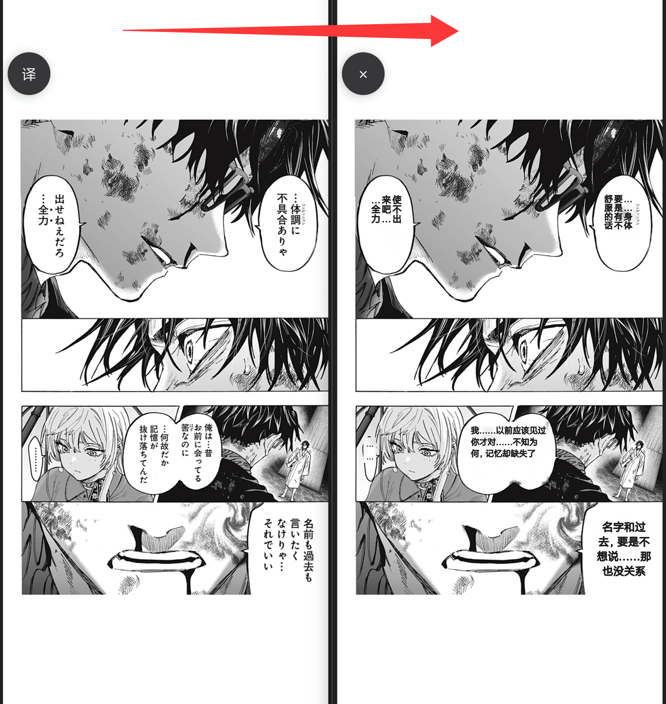
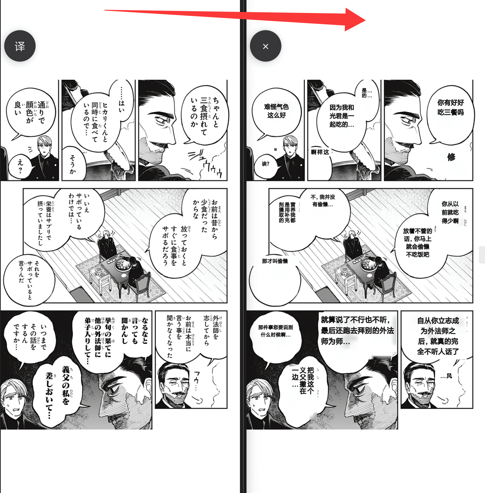

# 漫译 · MangaGlass

漫译是一款 Android 截图翻译工具，为漫画、游戏等画面提供中文翻译。打开阅读器或游戏后，点击悬浮球即可把当前画面翻译成中文，译文显示在原文字位置。

[下载安装包](https://github.com/DS-BigMountain/MangaGlass/releases/latest)

## 功能

- 翻译当前画面：点击悬浮球，当前页面立刻翻译；译文覆盖在原文气泡位置，阅读时省去对照。
- 两种翻译方式：AI 识图直接翻译整张截图；本地 OCR 先在本机识别文字再翻译，可自动判断或指定日语、英语、韩语。
- 竖排、横排漫画均可翻译，译文按原位置排版，尽量保持原有版面。
- 点按画面可查看原图；长按译文可放大阅读；双击译文可聚焦查看。
- 译文统一为简体中文。
- 自定义翻译服务：填写接口地址、密钥与模型即可使用，支持获取模型列表与测试图片翻译。
- 控制中心快捷开关，按日统计 Token 用量，查看最近 30 次翻译耗时。

## 示例

左图为翻译前的原页面与悬浮球，右图为点击悬浮球后的译文覆盖效果；点按画面可随时对照原图。

## 运行条件

- Android 8.0 或更高版本，联网环境。
- 兼容 HTTPS Chat Completions 的 API 服务与密钥。AI 识图方式需支持图片输入的模型；本地 OCR 方式需同一服务的文字模型。
- 悬浮窗与屏幕捕获权限，屏幕捕获范围选择整个屏幕。
- 本地 OCR 方式首次使用需准备约 250 MB 存储空间。

## 使用

1. 在「API 设置」中填写服务地址、密钥与模型，验证并保存。
2. 在首页「翻译方式」选择 AI 识图或本地 OCR；本地方式再选择识别语言。
3. 点击「开启悬浮球」，授予悬浮窗与屏幕捕获权限。
4. 打开漫画或游戏，点击「译」球翻译当前画面。
5. 点按画面查看原图，长按译文放大阅读，双击译文聚焦查看。
6. 点击「×」关闭译文后可继续翻页；长按悬浮球可停止服务。

AI 识图方式会上传完整截图，本地 OCR 方式会上传识别出的文字与位置，二者都会发送到所配置的翻译服务并可能产生费用。截图与译文仅用于本次翻译，密钥加密保存在本机。翻译效果取决于所选的模型与画面内容；受系统保护的画面在捕获时由系统限制。
